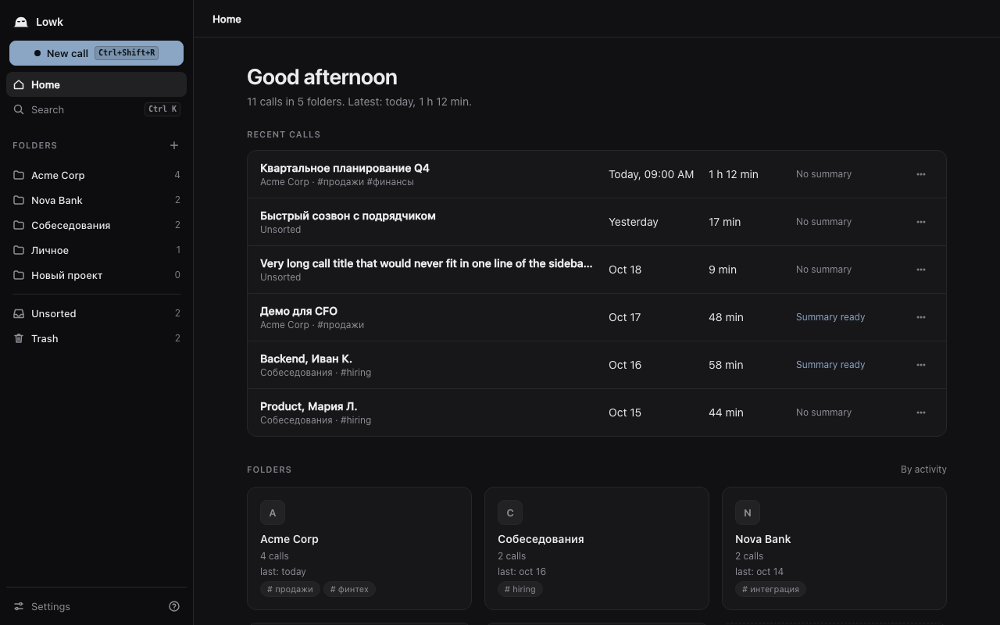
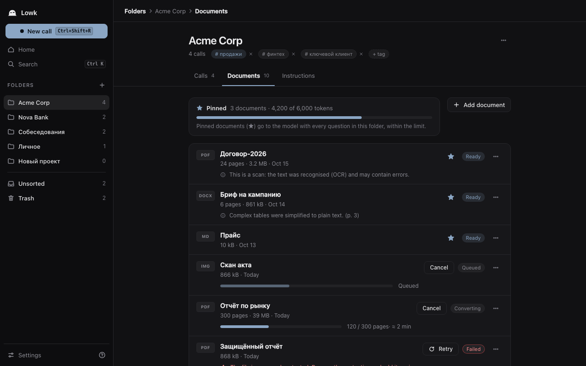
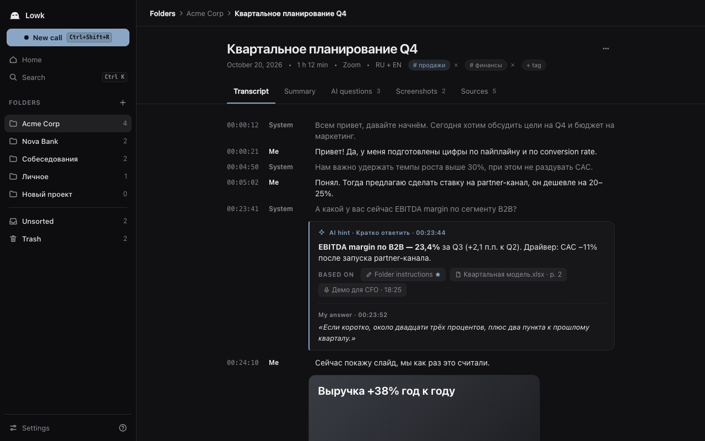
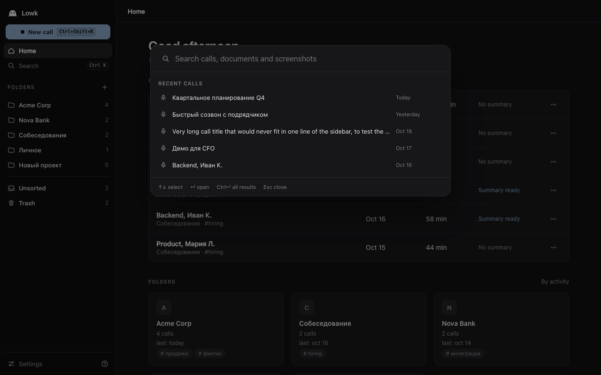

<p align="center"><picture><source media="(prefers-color-scheme: dark)" srcset="docs/design/logo/final/lowk-lockup-dark.svg"></picture></p>

<p align="center"><b>A quiet meeting copilot: live transcription, a private notes vault, and AI answers on a hotkey.</b></p>

<p align="center"><a href="README.ru.md">Русская версия</a> · <a href="docs/user-guide/en.md">User guide</a> · <a href="CONTRIBUTING.md">Contributing</a> · <a href="SECURITY.md">Security</a></p>

## What Lowk is

Lowk is an open-source (AGPL-3.0-or-later) desktop copilot for calls and interviews, for macOS and Windows.

- **Live transcription** of your microphone ("Me") and of the call app you pick ("System"), local by default (Nemotron streaming, with a Whisper pass that corrects finished phrases). Cloud engines (Deepgram, Soniox) are optional.
- **Stealth overlay** with subtitles and answers, excluded from screen sharing where the OS allows it.
- **AI answers on a hotkey**, not automatically. Cloud: DeepSeek through OpenRouter (bring your own key). Local: Ollama or LM Studio.
- **A Markdown vault** (Obsidian-compatible): folders, calls as `.md` files, documents, tags, hybrid search, post-call summary.
- English and Russian interface, no telemetry.

<p align="center"> </p>
<p align="center"> </p>
<p align="center"><sub>Main window. Captured from the UI running on a mock backend with sample data (the repo's visual test suite), not from real recordings.</sub></p>

## Status: pre-alpha

| Area | State |
|---|---|
| macOS (Apple Silicon, macOS 14+) | Primary target. Live transcription, overlay, hotkeys, vault and AI hints work and have been tested by hand on a MacBook Air M4. Rough edges are expected. |
| Windows 10/11 | Release builds exist but are **experimental**: see [docs/release.md](docs/release.md). Not verified on real hardware. |
| Documents, search, summary, Ask with context | Implemented. Documents (PDF, DOCX, PPTX, XLSX, CSV, TXT, MD, images with OCR), hybrid search, summary and tags, folder instructions, pinned documents, and AI answers that use folder context with source chips under the answer. Known limits: the embedding-model comparison and timing on Windows are unfinished. |
| Builds | Unsigned or self-signed, not notarized; test builds come from GitHub Actions ([docs/release.md](docs/release.md)) or build from source. No auto-update channel yet. |

Not implemented yet (see the [roadmap](docs/ROADMAP.md)): speaker diarization, slide capture, virtual camera, vault encryption, sync, process disguise.

## Privacy

Lowk has no telemetry and no account. The only automatic network request is a daily update check against GitHub, which can be switched off.

**Stays on your computer by default:** audio, transcripts, call and document files (plain Markdown in `~/Documents/Lowk`, or a folder or Obsidian vault you choose), the search index, and local speech models. Audio is not saved unless you turn that on.

**Leaves your computer only when you use a cloud feature:**

| Feature | Sent to | When |
|---|---|---|
| AI answer | OpenRouter (your key) | When you press the answer hotkey: new transcript text since the last answer, folder instructions, pinned and relevant document chunks, optionally a screenshot |
| Summary and tag suggestions | OpenRouter | When you press Summary after a call |
| Cloud transcription | Deepgram or Soniox (your key) | Only if you select a cloud engine |
| Cloud embeddings | The embedding provider | Only if you set embeddings to cloud (default is local) |
| Model downloads | Model hosts | When you install local speech or search models |
| Update check | GitHub | Daily, can be disabled |

Folders marked **local only** never use any cloud model (answers, summaries, tags, embeddings); they use a local LLM if you connected one, otherwise those buttons are disabled. API keys are stored in the OS keychain. Vault encryption is planned, not implemented: files are plain Markdown.

## Responsible use

Recording or transcribing a conversation may require the consent of other participants, depending on where you and they are. Following those laws and your employer's or school's rules is your responsibility. The stealth overlay hides Lowk from many screen-share paths but is not a guarantee. See the [user guide](docs/user-guide/en.md#stealth-limits).

## Build

Requirements: Rust (version pinned in `rust-toolchain.toml`), Node 22 and pnpm 10, [`just`](https://github.com/casey/just), the Tauri CLI (`cargo install tauri-cli --version "^2" --locked`), `cargo-deny`. macOS: Xcode command line tools and CMake (for the speech worker). Windows: MSVC build tools and WebView2.

```sh
just dev        # Tauri + Vite with hot reload
just build      # bundled Lowk.app (macOS), includes the speech worker
just bindings   # regenerate ui/src/lib/ipc/bindings.ts from Rust types
just ci         # fmt, clippy, dependency rules, licenses, tests, UI checks, cross-target lint
```

Layout: `crates/` (Rust crates, `lowk-types` at the bottom), `ui/` (Svelte 5 + Vite), `workers/` (speech worker), `tools/`, `docs/`. Architecture: [docs/architecture.md](docs/architecture.md); testing: [docs/testing.md](docs/testing.md).

## Roadmap

Available now: live transcription and overlay, documents, search, summary, retrieval in answers. Later: diarization, slide capture, virtual camera, encryption, sync, per-app audio capture on Windows 10. Details: [docs/ROADMAP.md](docs/ROADMAP.md).

## License and contributing

AGPL-3.0-or-later. See [LICENSE](LICENSE) and [NOTICE](NOTICE). Contributions need a DCO sign-off (`git commit -s`); see [CONTRIBUTING.md](CONTRIBUTING.md). Report vulnerabilities as described in [SECURITY.md](SECURITY.md).
