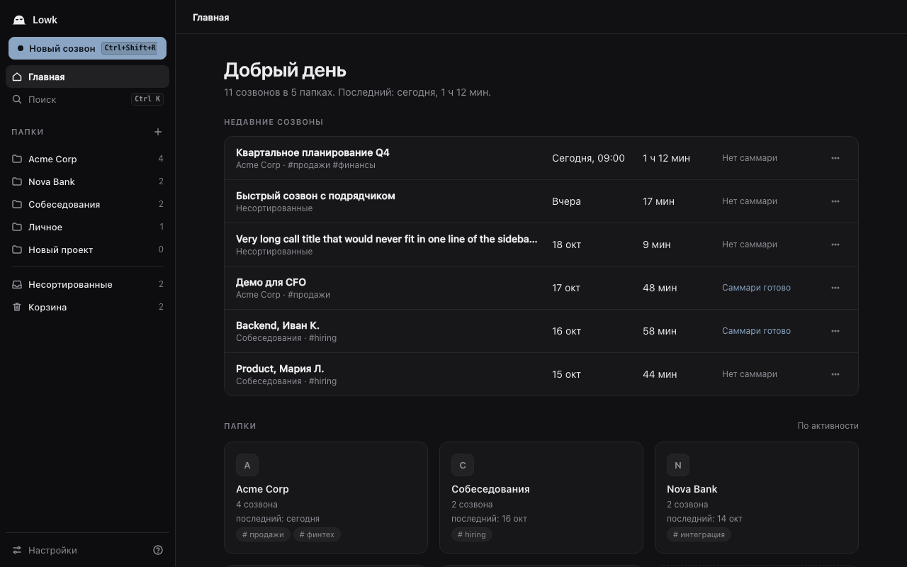
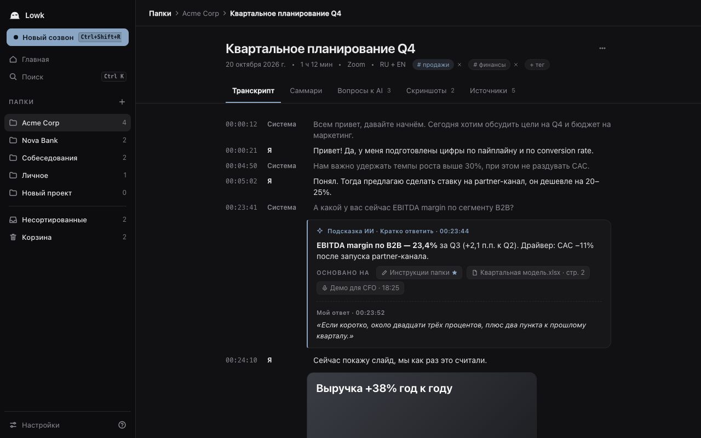

<p align="center"><picture><source media="(prefers-color-scheme: dark)" srcset="docs/design/logo/final/lowk-lockup-dark.svg"></picture></p>

<p align="center"><b>Тихий помощник на созвонах: транскрипция в реальном времени, личный архив заметок и ответы ИИ по горячей клавише.</b></p>

<p align="center"><a href="README.md">English</a> · <a href="docs/user-guide/ru.md">Руководство</a> · <a href="CONTRIBUTING.md">Участие в разработке</a> · <a href="SECURITY.md">Безопасность</a></p>

## Что такое Lowk

Lowk — десктопный помощник для созвонов и собеседований с открытым кодом (AGPL-3.0-or-later), для macOS и Windows.

- **Транскрипция в реальном времени** вашего микрофона («Я») и звука выбранного приложения («Система»). По умолчанию локально (потоковый Nemotron и проход Whisper, исправляющий завершённые фразы). Облачные движки (Deepgram, Soniox) — по желанию.
- **Стелс-оверлей** с субтитрами и ответами, скрытый от демонстрации экрана там, где это позволяет ОС.
- **Ответ ИИ по клавише**, а не автоматически. Облако: DeepSeek через OpenRouter (ваш ключ). Локально: Ollama или LM Studio.
- **Хранилище в Markdown** (совместимо с Obsidian): папки, созвоны в виде `.md`, документы, теги, гибридный поиск, саммари после созвона.
- Интерфейс на русском и английском, телеметрии нет.

<p align="center"> </p>
<p align="center"> </p>
<p align="center"><sub>Главное окно. Снимки интерфейса на мок-бэкенде с тестовыми данными (визуальные тесты репозитория), а не реальные записи.</sub></p>

## Установка

Скачайте последнюю сборку на странице [Releases](https://github.com/lifechangee/Lowk/releases).

**Требования:** macOS 14.4 и новее на Apple Silicon либо Windows 11 (x64). На Windows 10 работает только захват всего системного звука (без отдельных приложений). Около 3 ГБ свободного места под локальные модели распознавания: они скачиваются при первом запуске.

**macOS**
1. Откройте `Lowk-<версия>.dmg` и перетащите Lowk в «Программы».
2. Lowk не нотаризован Apple, поэтому первый запуск блокируется. Закройте окно предупреждения, откройте **Системные настройки > Конфиденциальность и безопасность**, прокрутите вниз до сообщения о Lowk и нажмите **Всё равно открыть**.
3. Если кнопки нет, выполните в Терминале `xattr -dr com.apple.quarantine /Applications/Lowk.app` и откройте приложение снова.

**Windows**
1. Запустите `Lowk-<версия>-setup.exe` (установщик NSIS).
2. SmartScreen покажет «Windows защитила ваш компьютер»: нажмите **Подробнее**, затем **Выполнить в любом случае**. Установщик пока без подписи кода.

**Первый запуск.** Короткая настройка проведёт по шагам: язык интерфейса, уведомление о законах о записи (подтверждается один раз), источник звука, системные разрешения (macOS: микрофон, системный звук, запись экрана, мониторинг ввода, универсальный доступ; статус обновляется сам, кнопка «Открыть настройки» ведёт в нужный раздел), движок распознавания и загрузка модели, необязательные API-ключи (OpenRouter для ответов, Deepgram или Soniox для облачной транскрипции; можно пропустить), папка заметок и горячие клавиши. Всё можно изменить позже в настройках, а прерванная настройка продолжится с того же места. Подробнее в [руководстве](docs/user-guide/ru.md).

## Статус: пре-альфа

| Область | Состояние |
|---|---|
| macOS (Apple Silicon, macOS 14.4+) | Основная платформа. Живая транскрипция, оверлей, горячие клавиши, хранилище и подсказки ИИ работают и проверены вручную на MacBook Air M4. Шероховатости ожидаемы. |
| Windows 10/11 | Релизные сборки есть, но **экспериментальные**: см. [docs/release.md](docs/release.md). На реальном железе не проверены. |
| Документы, поиск, саммари, Ask с контекстом | Реализовано. Документы (PDF, DOCX, PPTX, XLSX, CSV, TXT, MD, картинки с OCR), гибридный поиск, саммари и теги, инструкции папки, закреплённые документы и ответы ИИ с контекстом папки и метками источников под ответом. Известные ограничения: сравнение моделей эмбеддингов и замеры на Windows не доделаны. |
| Сборки | Без нотаризации Apple, с самоподписью; тестовые сборки берутся из GitHub Actions ([docs/release.md](docs/release.md)) или собираются из исходников. Автообновления пока нет. |

**Известные ограничения:** установщики без подписи (см. выше); автообновления пока нет; Windows не проверен на реальном железе; на Windows 10 захватывается только весь системный звук; оверлей скрыт от распространённых способов демонстрации экрана, но гарантии нет; нет диаризации; файлы хранилища не шифруются.

Ещё не сделано (см. [роадмап](docs/ROADMAP.md)): диаризация, снимки слайдов, виртуальная камера, шифрование хранилища, синхронизация, маскировка процесса.

## Приватность

В Lowk нет телеметрии и аккаунтов. Единственный автоматический сетевой запрос — ежедневная проверка обновлений на GitHub, её можно выключить.

**По умолчанию остаётся на вашем компьютере:** аудио, транскрипты, файлы созвонов и документов (обычный Markdown в `~/Documents/Lowk` или в выбранной вами папке или хранилище Obsidian), поисковый индекс, локальные модели. Аудио не сохраняется, пока вы не включите это.

**Уходит с компьютера только при использовании облачной функции:**

| Функция | Куда | Когда |
|---|---|---|
| Ответ ИИ | OpenRouter (ваш ключ) | При нажатии клавиши ответа: новый текст с прошлого ответа, инструкции папки, закреплённые и релевантные куски документов, при желании скриншот |
| Саммари и подбор тегов | OpenRouter | При нажатии «Саммари» после созвона |
| Облачная транскрипция | Deepgram или Soniox (ваш ключ) | Только если выбран облачный движок |
| Облачные эмбеддинги | Провайдер эмбеддингов | Только если выбрано «облако» (по умолчанию локально) |
| Загрузка моделей | Хостинги моделей | При установке локальных моделей речи и поиска |
| Проверка обновлений | GitHub | Раз в день, можно выключить |

Папки «только локально» никогда не используют облачные модели (ответы, саммари, теги, эмбеддинги); работает локальная LLM, если вы её подключили, иначе кнопки неактивны. API-ключи хранятся в связке ключей ОС. Шифрование хранилища запланировано, но не реализовано: файлы — обычный Markdown.

## Ответственное использование

Запись и транскрипция разговора могут требовать согласия остальных участников — в зависимости от страны. Соблюдать эти законы и правила работодателя или учебного заведения должны вы. Стелс-оверлей скрывает Lowk от многих путей демонстрации экрана, но не гарантирует этого. См. [руководство](docs/user-guide/ru.md#границы-стелса).

## Сборка

Требования: Rust (версия закреплена в `rust-toolchain.toml`), Node 22 и pnpm 10, [`just`](https://github.com/casey/just), Tauri CLI (`cargo install tauri-cli --version "^2" --locked`), `cargo-deny`. macOS: Xcode command line tools и CMake (для речевого воркера). Windows: MSVC build tools и WebView2.

```sh
just dev        # Tauri + Vite с горячей перезагрузкой
just build      # собранный Lowk.app (macOS) вместе с речевым воркером
just bindings   # перегенерировать ui/src/lib/ipc/bindings.ts из типов Rust
just ci         # fmt, clippy, правила зависимостей, лицензии, тесты, проверки UI, кросс-линт
```

Структура: `crates/` (Rust-крейты, внизу `lowk-types`), `ui/` (Svelte 5 + Vite), `workers/` (речевой воркер), `tools/`, `docs/`. Архитектура: [docs/architecture.md](docs/architecture.md), тесты: [docs/testing.md](docs/testing.md).

## Роадмап

Уже работает: живая транскрипция и оверлей, документы, поиск, саммари, контекст в ответах. Позже: диаризация, снимки слайдов, виртуальная камера, шифрование, синхронизация, захват отдельного приложения на Windows 10. Подробнее: [docs/ROADMAP.md](docs/ROADMAP.md).

## Лицензия и участие

AGPL-3.0-or-later. См. [LICENSE](LICENSE) и [NOTICE](NOTICE). Для вкладов нужен DCO sign-off (`git commit -s`); см. [CONTRIBUTING.md](CONTRIBUTING.md). Об уязвимостях сообщайте по [SECURITY.md](SECURITY.md).
