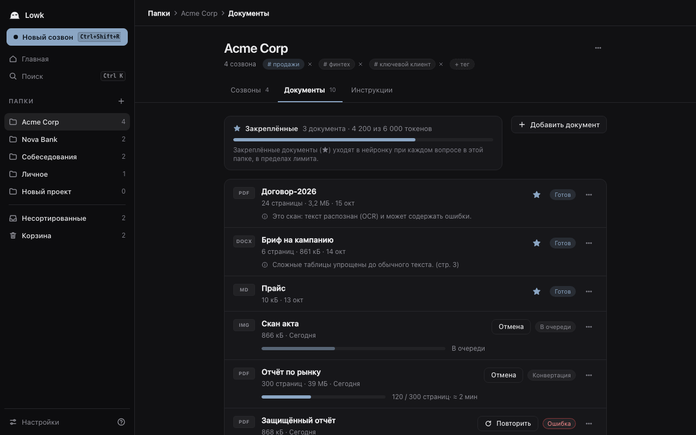
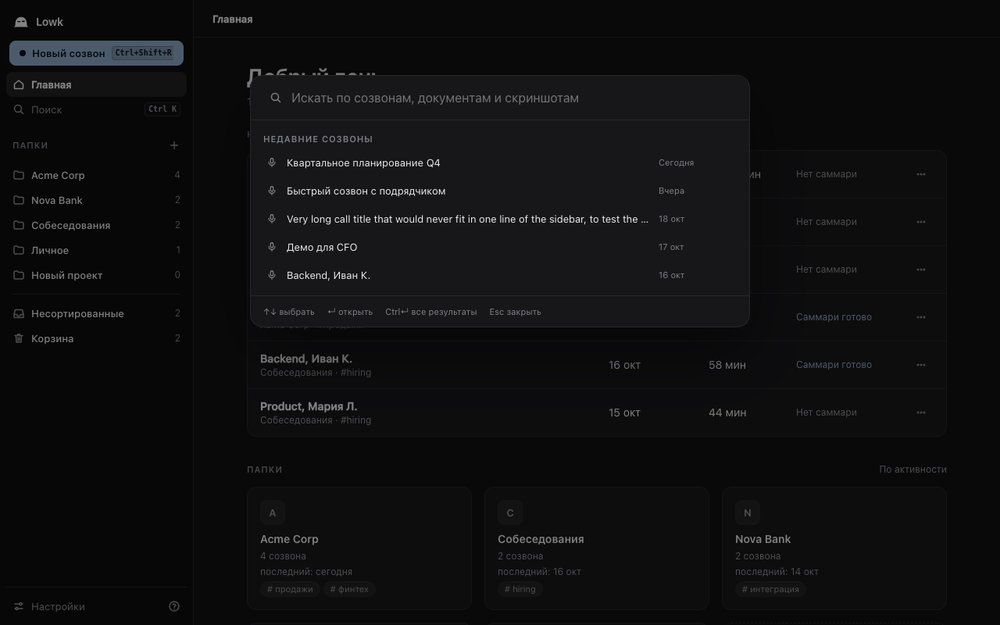

# Руководство пользователя Lowk

[English version](en.md) · [Назад к README](../../README.ru.md)

Lowk — **пре-альфа**. Здесь описано то, что сделано на macOS. Релизные сборки для Windows экспериментальные ([docs/release.md](../release.md)) и на реальном железе не проверены. Всё, что помечено «запланировано», пока не существует.

## Содержание

1. [Установка и предупреждение о неподписанном приложении](#установка)
2. [Разрешения и зачем каждое нужно](#разрешения)
3. [Первый созвон](#первый-созвон)
4. [Горячие клавиши, включая удержание](#горячие-клавиши)
5. [Языки](#языки)
6. [Папки, документы, поиск, саммари](#хранилище)
7. [Папки «только локально»](#папки-только-локально)
8. [Границы стелса](#границы-стелса)
9. [Согласие на запись: ваша ответственность](#согласие-на-запись)

## Установка

Тестовые сборки (macOS `.dmg`/`.app.zip` и экспериментальные установщики Windows) делает GitHub Actions: см. [docs/release.md](../release.md), там же про предупреждение Windows SmartScreen. Иначе соберите приложение сами (`just build`, см. [README](../../README.ru.md)); получится `target/release/bundle/macos/Lowk.app`. Скопируйте его в «Программы». Требования: Apple Silicon, macOS 14 и новее.

Lowk не нотаризован Apple (подпись ad hoc или самоподписанный сертификат), поэтому при первом запуске Gatekeeper его заблокирует:

1. Дважды щёлкните `Lowk.app`. macOS сообщит, что не может проверить приложение. Закройте окно.
2. Откройте «Системные настройки», «Конфиденциальность и безопасность», прокрутите до сообщения о Lowk и нажмите **«Всё равно открыть»**, подтвердите. (Либо правый клик по приложению, «Открыть», ещё раз «Открыть».)

Пересобранное приложение macOS может счесть «новым» и сбросить разрешения ниже. Если после обновления перестали работать транскрипция или клавиши, выдайте их заново.

Ключи и данные: ключ OpenRouter или облачной транскрипции хранится в связке ключей macOS. Хранилище — обычный Markdown в `~/Documents/Lowk`, если не выбрана другая папка (подойдёт хранилище Obsidian).

## Разрешения

Онбординг просит всё сразу, есть кнопка «пропустить». Позже каждое можно выдать или изменить в Настройках, «Разрешения», и в системных настройках.

| Разрешение | Зачем | Если отказать |
|---|---|---|
| Микрофон | Транскрибировать ваш голос (метка «Я») | Нет строк «Я» |
| Системный звук | Транскрибировать выбранное приложение созвона (метка «Система») | Нет транскрипта собеседников |
| Запись экрана | Скриншоты по вашему запросу и подстройка цвета оверлея под фон. Окна самого Lowk в кадр не попадают | Нет скриншотов и адаптивного оверлея |
| Мониторинг ввода | Клавиши-удержания (⌥ перемещение, ⌃ мышь) и боковые кнопки мыши как бинды. Lowk смотрит только на назначенные вами клавиши и не логирует набор текста | Удержания не работают; перемещение ⌥ заменяется переключателем «нажал — следует, нажал — отпустил» |
| Универсальный доступ (по желанию) | Только чтобы «съесть» назначенную кнопку мыши, чтобы браузер не получал «Назад» | Назначенные кнопки видны, но доходят и до других приложений |

Если macOS снова и снова просит разрешение, удалите Lowk из списка в системных настройках, добавьте заново и перезапустите Lowk.

## Первый созвон

1. Запустите Lowk и пройдите онбординг. Выберите источник звука по умолчанию (лучше конкретное приложение созвона, чтобы вкладка с YouTube не мешала) и языки созвона.
2. Локальные модели речи скачиваются по требованию. Установите их по подсказке Lowk: есть прогресс, отмена и докачка. Без моделей локально транскрибировать нельзя, Lowk скажет об этом и не подсовывает выдуманный текст.
3. Для ответов ИИ откройте Настройки, «Провайдеры» и вставьте ключ OpenRouter (или подключите Ollama или LM Studio). Без провайдера клавиша ответа покажет уведомление вместо ответа.
4. Нажмите **«Новый созвон»** (или ⌘⇧R), выберите папку и источник звука, начните. Оверлей появится на основном мониторе с живыми субтитрами: «Я» и «Система».
5. Когда прозвучал вопрос, нажмите ⌘↵. Текст на этот момент (включая недоговорённую фразу) уходит сразу, ответ стримится в оверлей. Всё, что вы скажете после, отображается как «Мой ответ» до следующего нажатия. ⌘⇧↵ просит модель дополнить уже сказанное вами.
6. Остановите запись. Созвон сохранится как Markdown-файл в папке. На странице созвона кнопка **«Саммари»** даёт главное, решения и задачи.

По умолчанию хранится только текст. Сохранение аудио включается отдельно для созвона и по умолчанию выключено.

## Горячие клавиши

Значения по умолчанию для macOS (Windows: Ctrl вместо ⌘, Alt вместо ⌥). Всё меняется в Настройках, «Горячие клавиши», включая боковые кнопки мыши.

| Действие | По умолчанию |
|---|---|
| Спросить ИИ (шаблон «Кратко») | ⌘↵ |
| Спросить ИИ (шаблон «Дополни мой ответ») | ⌘⇧↵ |
| Скриншот (все мониторы) | ⌘⇧S |
| Скриншот области | ⌘⇧A |
| Интерактивный режим (ввод текста в оверлее) | ⌘⇧I |
| Показать или скрыть оверлей | ⌘\ |
| Начать или остановить запись | ⌘⇧R |
| **Удержание ⌥**: перемещение оверлея | удержание |
| **Удержание ⌃**: мышь активна над оверлеем | удержание |

Удержания:

- **Удержание ⌥.** Оверлей «примагничивается» к курсору и следует за ним, пока вы держите: без клика и без смены курсора; отпустили — оверлей остался на месте. Работает в любом режиме. Нужен «Мониторинг ввода»; без него используйте запасной переключатель.
- **Удержание ⌃.** Пока держите, мышь активна над оверлеем (кнопки, выбор шаблона, перетаскивание за шапку). Отпустили — клики снова проходят в приложение под ним, так что оверлей не крадёт фокус у созвона.

На клавиши можно назначить и другие шаблоны, в том числе свои.

## Языки

Язык интерфейса следует языку системы (русский или английский), его можно переключить в Настройках. Отдельно вы выбираете **языки созвона** (по умолчанию русский и английский, или язык системы) в Настройках и перед каждым созвоном. Распознавание и фильтр «чужих» букв ограничены выбранными языками; смешанная речь («а что значит EBITDA?») поддерживается. В списке только языки, которые поддерживает движок.

## Хранилище

Хранилище — папка с Markdown-файлами, которую можно открыть в Obsidian как есть: **папка** (проект или клиент) содержит **созвоны** (`.md`) и **документы**. Системные папки: «Несортированные» (созвоны без папки) и «Корзина» (оттуда восстанавливают; хранится, пока вы не очистите). **«Удалить папку»** (меню ⋯ папки в боковой панели или на её странице) спрашивает подтверждение с числом созвонов и документов и переносит папку со всем содержимым в корзину; «Восстановить» там возвращает всё, «Очистить корзину» удаляет навсегда вместе с сохранённым звуком. Папку, где идёт запись, удалить нельзя. «В корзину» есть и в меню ⋯ каждого созвона в списках, с кнопкой «Отменить». В старых файлах может остаться `tags:` в front matter: Lowk их не трогает, но больше не показывает, не пишет и не предлагает теги.

Главное окно: одна боковая панель с «Новый созвон», «Главная», «Поиск», деревом папок, «Несортированные», «Корзина» и «Настройки». У папки вкладки **Созвоны / Документы / Инструкции**; у созвона **Транскрипт / Саммари / Вопросы к AI / Скриншоты / Источники**. При первом запуске идёт короткий тур, его можно повторить из Настроек.

Документы. Поддерживаются: PDF (текстовые и сканы), DOCX, PPTX, XLSX, CSV, TXT, MD и картинки (OCR); Keynote — только на macOS (проверкой сборки покрыты PDF, XLSX, DOCX, PPTX, CSV, MD и скан PDF). Перетащите файлы в папку или нажмите «Добавить документ». Оригинал хранится рядом с конвертированным `.md`. Если файл не удалось конвертировать, вы увидите ошибку на нём, а не пустой документ.

- **Закрепление** документа звёздочкой: он всегда уходит в запросы к ИИ (в пределах лимита токенов, он виден в интерфейсе).
- **Инструкции** — короткий текст (около 500 токенов), который всегда отправляется с запросами этой папки.
- **Поиск** (⌘K и страница результатов): одна строка по созвонам, документам и тексту скриншотов; фильтры по папке и дате; результат открывает созвон на нужной минуте или документ на странице. Поиск по смыслу использует локальную модель эмбеддингов (около 310 МБ, скачивается по требованию). Пока её нет или идёт построение, результаты помечены режимом «по ключевым словам».
- **Саммари** (кнопка после созвона): 3–5 главных пунктов, решения, задачи и вопросы к вам. Делает облачная модель (DeepSeek через OpenRouter) с вашим ключом.
- **Экспорт и импорт** всего хранилища или одной папки в zip. Импорт ничего не перезаписывает.

**Ask использует ваш контекст.** По клавише ответа Lowk добавляет инструкции папки, закреплённые документы, релевантные куски её документов и релевантные части прошлых созвонов этой же папки (текущий созвон не берётся: он уходит как живая дельта). Источники показываются метками под ответом в оверлее и на вкладке «Источники» созвона; клик открывает источник. Скриншоты в руководстве — тестовые данные из UI-тестов.

Оговорки: это пре-альфа. Сравнение моделей эмбеддингов и замеры на Windows не доделаны.

## Папки «только локально»

Отметьте папку как **«только локально»**, и Lowk никогда не отправит её содержимое в облачную модель: ни ответы, ни саммари, ни облачные эмбеддинги. Если подключена локальная LLM (Настройки, провайдеры: локальный адрес и модель Ollama или LM Studio), используется она; иначе облачный маршрут отклоняется, а кнопки неактивны с объяснением. Запрет проверяется на стороне бэкенда для ответов, саммари, поиска контекста и облачных эмбеддингов. Учтите: выбранный облачный движок транскрипции всё равно получает звук созвона, поэтому для чувствительных разговоров используйте локальную транскрипцию.

## Границы стелса

Оверлей исключён из захвата экрана флагами окна ОС и скрыт из Dock, переключателя приложений и трея. В скриншоты, которые делает сам Lowk, он не попадает. Имейте в виду:

- Это работает, пока программа демонстрации уважает флаг ОС. Многие уважают; часть путей захвата (некоторые средства записи, карты захвата, телефон, снимающий экран, удалённые рабочие столы, будущие изменения ОС) могут его показать. **Проверьте на своём приложении для встреч и втором экране, прежде чем на это полагаться.**
- Процесс Lowk виден в «Мониторинге системы» или «Диспетчере задач». Скрытие или маскировка процесса не делается (смена имени и иконки запланирована).
- Курсор мыши виден на демонстрации экрана. Поэтому перемещение оверлея сделано удержанием клавиши и не меняет курсор.
- Главное окно не стелс. Стелс только у оверлея.
- Захват звука ничего не воспроизводит для собеседников, но платформа созвона может сама уведомлять участников о записи — по своим правилам.

## Согласие на запись

Запись и транскрипция разговора, а также использование ИИ-помощника на собеседованиях или экзаменах могут регулироваться или запрещаться законом, работодателем, учебным заведением или правилами встречи. Во многих странах требуется согласие всех участников. **Знать и соблюдать эти правила — ваша ответственность.** Авторы предоставляют Lowk «как есть», без гарантий, на условиях AGPL-3.0-or-later, и не отвечают за то, как вы его используете.

## Удаление

В Windows удаляйте Lowk через «Параметры» → «Приложения». По умолчанию деинсталлятор сохраняет настройки, скачанные модели и журналы, поэтому после переустановки всё на месте. Чтобы удалить и их, отметьте на странице удаления галочку **Удалить настройки, модели и журналы Lowk** (по умолчанию она снята). Будут удалены `%APPDATA%\Lowk` и сохранённые ключи API в Диспетчере учётных данных Windows. Ваше хранилище (заметки в `Documents\Lowk` или в выбранной папке) не удаляется никогда.
